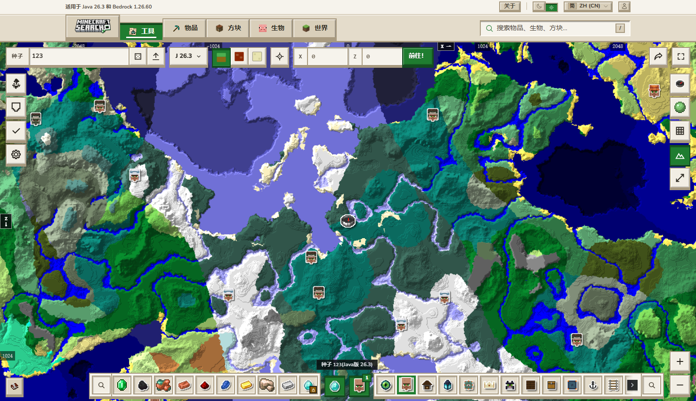
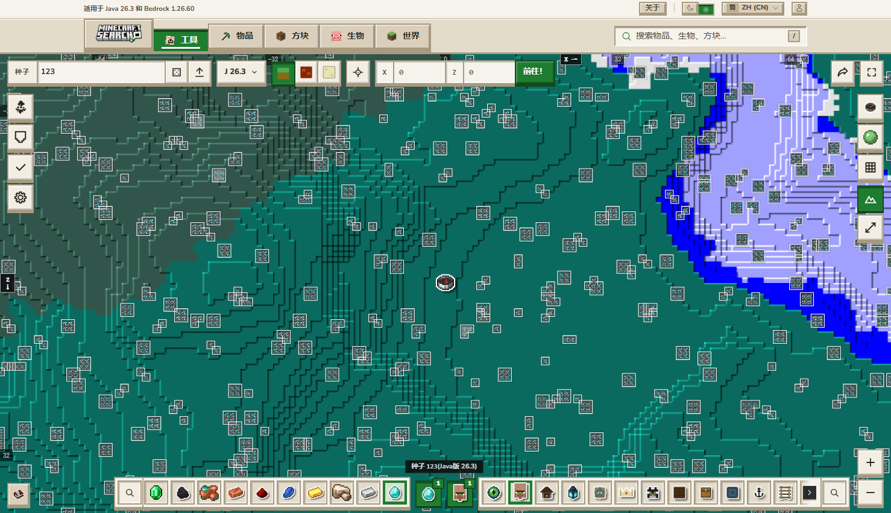

# Minecraft Seed Map · Local Offline Edition

**English** | [简体中文](README.md)

A complete local, offline copy of `minecraftsearch.com/tools/seed-map`. The original UI and interactions are preserved, while the paid gate and the extra languages are removed.



## Usage

**Double-click `启动.bat`** — it starts a local server and opens your browser.

```
Chinese (default): http://127.0.0.1:3456/zh-CN/tools/seed-map
English          : http://127.0.0.1:3456/tools/seed-map
```

Visiting `/` redirects to the Chinese version. Close the console window to stop the server.

Or run it directly:

```bash
node serve.mjs 3456
```

> It has to be served over http — double-clicking an html file will not work. Next.js chunks are loaded via `importScripts` / `fetch`, which browsers block under `file://`.
>
> `启动.bat` is deliberately written in pure ASCII: cmd parses `.bat` files using the system code page (GBK), so UTF-8 Chinese inside the script would be torn into garbage commands.

Double-clicking twice does no harm: if the port is already held by this server, the script simply opens the browser.
If some other program holds the port, it tells you to switch: `node serve.mjs 3457`.

## Features

- 3D terrain rendering, structure icons, item bar, version dropdown (26.4 – 1.0), three dimensions (Overworld / Nether / End)
- Drag to pan, scroll to zoom, deep-link hash, chunk coordinates
- Ore finder: diamond, iron, gold, lapis and the rest are all fully available
- Languages: Simplified Chinese + English

## Local modifications

Three changes are applied to the mirrored chunks. The original files are backed up as `.orig` and can be restored at any time.

### 1. Unlocking the diamond finder

The original site treats "diamond hotspots" as a paid perk (clicking diamond pops a ¥129 upgrade dialog and only grants one free scan of 3 veins).
This has been removed locally — diamond now produces the full heatmap just like every other ore.



```bash
node tools/unlock-diamond.mjs            # apply the patch
node tools/unlock-diamond.mjs --restore  # revert
```

Four places in `0tq-rl8a74ptl.js`:

| Location | Original behaviour |
| --- | --- |
| `lockedOres` | marks diamond as locked, so the chip goes straight to `onLockedOre` |
| effect on selecting diamond | clears the selected set and `return`s, skipping the normal flow |
| the other effect | actively deletes diamond from the selected set |
| `ax` callback | at click time the set hasn't updated yet, so it opens the upsell immediately |

### 2. Keeping only Chinese and English

The original site supports 40+ languages; the local menu only lists English and Simplified Chinese (the dropdown shows 2/2).

```bash
node tools/trim-locales.mjs            # trim
node tools/trim-locales.mjs --restore  # revert
```

This replaces the locale array (`{code,name,flagCode,autonym}`) in three chunks with just those two entries.

### 3. Hiding the "Supporter" promotions

The supporter promo card, upgrade entries and "support us" links are all hidden. The conditionally triggered
`supporter-nudge` banner on the map is blocked pre-emptively as well (via CSS, `display:none`, which also
covers dynamically inserted nodes).

```bash
node tools/hide-supporter.mjs            # hide
node tools/hide-supporter.mjs --restore  # revert
```

It works by injecting a stylesheet before `</head>` in both entry HTML files:

```css
[data-v3="supporter-nudge"],[data-v3="supporter-card"],[data-v3="supporter-row"],
[data-v3="supporter-thanks"],a[href$="/supporter"]{display:none!important}
```

> CSS was chosen over removing nodes: React won't error out on missing nodes when it re-renders, and there's no need to watch for DOM mutations.

## Layout

```
启动.bat                  # entry point, double-click to run
serve.mjs                 # local static server (zero dependencies, with a /_next/image shim)
README.md                 # Chinese
README.en.md              # this file
LICENSE
mirror/                   # site mirror, 1496 files / 28.9 MB
  _next/                  # JS chunks, CSS, fonts, worker runtime
  wasm/                   # cubiomes engine (4 wasm builds + 4 Emscripten glue files)
  images/                 # structure icons, block/item icons
  worldgen/               # terrain and structure layout JSON
  zh-CN/ tools/           # Chinese and English HTML entry points
docs/
  cubiomes-wasm-api.md    # reverse-engineering notes: export symbol map, calling protocol, enums
  mirror-preview-zh.png
  mirror-diamond.png
crawl/requests*.json      # runtime asset manifests of the site (input for the mirror)
tools/                    # crawl / patch / verify scripts
```

## Core algorithm

All terrain generation on the site happens inside WebAssembly in the browser; the server only provides analytics and RSC prefetching.
The engine is a compiled build of the open-source C library [cubiomes](https://github.com/Cubitect/cubiomes), with export
symbols mangled to single letters. The name mapping was recovered from the calling protocol — see
[docs/cubiomes-wasm-api.md](docs/cubiomes-wasm-api.md).

## Notes

- Node.js is required (`启动.bat` checks for it).
- `Blog / About / Items / Blocks / Mobs / World` point at pages that were not mirrored and will 404; the seed map itself is unaffected.
- Features that depend on a backend — accounts, favourites, sharing — are unavailable.
- Client-side route transitions fall back to full page reloads (there is no local RSC payload). Functionality is unaffected, it's just a bit slower.
- The mirror is pinned to the moment it was captured (version tag `20261028-e3e-quart`); it won't follow upstream updates.

## License

The **original parts of this repository** — `serve.mjs`, everything under `tools/`, and the documents in `docs/` — are
licensed under the [Apache License 2.0](LICENSE), Copyright 2026 xiushabei.

**The following is NOT covered by that license:**

- The `mirror/` directory is a copy of assets from the `minecraftsearch.com` site (HTML / JS / CSS / images / worldgen data).
  Copyright belongs to the original site's authors. It is kept here as a local copy for personal study and research only —
  Apache-2.0 does **not** apply, and it should not be redistributed.
- `mirror/wasm/cubiomes.wasm` derives from the open-source project [cubiomes](https://github.com/Cubitect/cubiomes) (MIT)
  and remains under its original license.
- Minecraft is a trademark of Mojang Studios. This project is not affiliated with Mojang or Microsoft.
