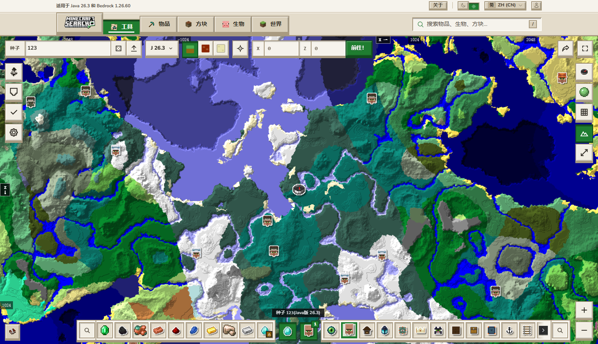
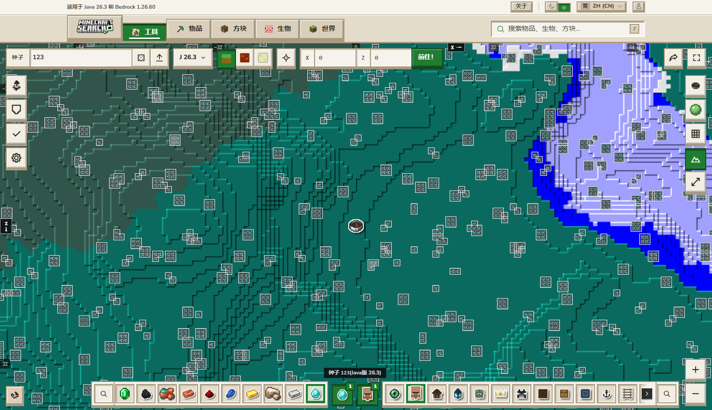

# Minecraft 种子地图 · 本地离线版

**简体中文** | [English](README.en.md)

把 `minecraftsearch.com/tools/seed-map` 完整搬到本地离线运行，保留原版 UI 与交互，并去掉了付费门禁与多余语言。



## 用法

**双击 `启动.bat`** —— 起本地服务并自动打开浏览器。

```
中文（默认）：http://127.0.0.1:3456/zh-CN/tools/seed-map
英文        ：http://127.0.0.1:3456/tools/seed-map
```

访问根路径 `/` 会自动跳转到中文版。关闭命令行窗口即停止服务。

也可以直接跑：

```bash
node serve.mjs 3456
```

> 必须走 http 而不能双击 html：Next.js 的 chunk 用 `importScripts` / `fetch` 加载，`file://` 下会被浏览器拦死。
>
> `启动.bat` 刻意写成纯 ASCII：cmd 按系统代码页（GBK）解析 `.bat`，脚本里放 UTF-8 中文会被拆成乱码命令。

重复双击不会报错：脚本检测到端口已被本服务占用时，会直接打开浏览器。
端口被别的程序占用时会提示换端口 `node serve.mjs 3457`。

## 功能

- 3D 地形渲染、结构图标、物品栏、版本下拉（26.4 ~ 1.0）、三维度切换（主世界 / 下界 / 末地）
- 拖拽缩放、深链接 hash、区块坐标显示
- 矿石查找器：钻石、铁、金、红宝石等全部可用
- 语言：简体中文 + English

## 本地定制

三处改动打在镜像的 chunk 上，原始文件都备份为 `.orig`，可随时还原。

### 1. 解锁钻石查找

原站把「钻石热点」设成付费权益（点钻石弹 129 元升级框，只给 1 次免费扫描 3 个矿脉）。
本地版已解除，钻石和其他矿石一样直接出完整热力图。



```bash
node tools/unlock-diamond.mjs            # 打补丁
node tools/unlock-diamond.mjs --restore  # 还原
```

共 4 处（`0tq-rl8a74ptl.js`）：

| 位置 | 原逻辑 |
| --- | --- |
| `lockedOres` | 把 diamond 标记为锁定，chip 直接走 `onLockedOre` |
| 选中 diamond 的 effect | 清空已选集合并 `return`，不进入正常流程 |
| 另一个 effect | 主动把 diamond 从已选集合里删掉 |
| `ax` 回调 | 点击当下集合还没更新，直接弹升级框 |

### 2. 语言只保留中英文

原站支持 40+ 语言，本地版菜单只剩 English 与简体中文（下拉显示 2/2）。

```bash
node tools/trim-locales.mjs            # 精简
node tools/trim-locales.mjs --restore  # 还原
```

把 3 个 chunk 里的语言数组（`{code,name,flagCode,autonym}`）整段替换成两项。

### 3. 隐藏「支持者」推广

页面里的支持者推广卡片、升级入口、"支持我们"链接全部隐藏；地图上那个条件触发的
`supporter-nudge` 横幅也一并预防性屏蔽（用 CSS，`display:none`，对动态插入的节点同样生效）。

```bash
node tools/hide-supporter.mjs            # 隐藏
node tools/hide-supporter.mjs --restore  # 还原
```

做法是在两个入口 HTML 的 `</head>` 前注入一段样式：

```css
[data-v3="supporter-nudge"],[data-v3="supporter-card"],[data-v3="supporter-row"],
[data-v3="supporter-thanks"],a[href$="/supporter"]{display:none!important}
```

> 选 CSS 而不是删节点：React 重新渲染时不会因为节点缺失而报错，且不需要监听 DOM 变化。

## 目录

```
启动.bat                  # 入口，双击即用
serve.mjs                 # 本地静态服务器（零依赖，含 /_next/image 兼容层）
README.md
mirror/                   # 站点镜像，1496 个文件 / 28.9 MB
  _next/                  # JS chunk、CSS、字体、worker 运行时
  wasm/                   # cubiomes 引擎（4 份 wasm + 4 份 Emscripten glue）
  images/                 # 结构图标、方块/物品图标
  worldgen/               # 地形与结构布局 JSON
  zh-CN/ tools/           # 中英文两套 HTML 入口
docs/
  cubiomes-wasm-api.md    # 核心算法逆向记录：导出符号映射、调用协议、枚举表
  mirror-preview-zh.png
  mirror-diamond.png
crawl/requests*.json      # 站点运行时资源清单（镜像的输入）
tools/                    # 抓取 / 补丁 / 验证脚本
```
## 核心算法

站点所有地形计算都在浏览器的 WebAssembly 里完成，服务端只提供埋点和 RSC 预取。
引擎是开源 C 库 [cubiomes](https://github.com/Cubitect/cubiomes) 编译的产物，导出符号被压成单字母，
通过调用协议反推出映射，详见 [docs/cubiomes-wasm-api.md](docs/cubiomes-wasm-api.md)。

## 注意
- 需要 Node.js（`启动.bat` 会检查）。
- `Blog / About / Items / Blocks / Mobs / World` 这些导航指向未镜像的页面，点了会 404；种子地图本身不受影响。
- 账号、收藏、分享等依赖后端的功能不可用。
- 客户端路由跳转走整页刷新（本地没有 RSC payload），功能不受影响，只是慢一点。
- 镜像固定在抓取那一刻（版本表 `20261028-e3e-quart`），站点更新后不会自动跟。

## 许可证

本仓库**自有部分**——`serve.mjs`、`tools/` 下的全部脚本、`docs/` 中的文档——采用
[Apache License 2.0](LICENSE)，Copyright 2026 xiushabei。

**以下内容不在该许可范围内：**

- `mirror/` 目录是对 `minecraftsearch.com` 站点资源的镜像（HTML / JS / CSS / 图片 / worldgen 数据）。
  其版权归原站点作者所有，此处仅作个人学习与研究用途的本地副本，**不适用** Apache-2.0，也请勿再分发。
- `mirror/wasm/cubiomes.wasm` 衍生自开源项目 [cubiomes](https://github.com/Cubitect/cubiomes)（MIT），
  遵循其原有许可。
- Minecraft 是 Mojang Studios 的商标，本项目与 Mojang / Microsoft 无任何关联。

